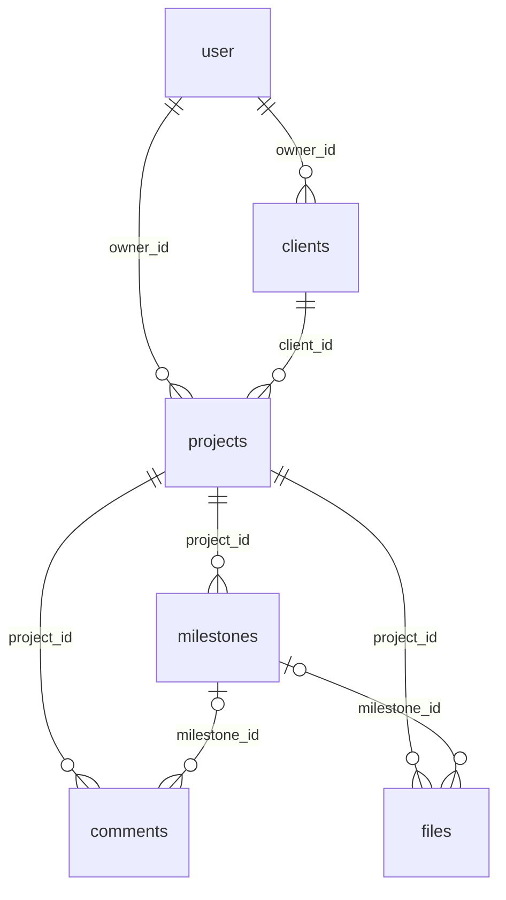

# StatusDEV

Портал клієнта для фрілансерів: власник веде клієнтів, проєкти й етапи, а клієнт за секретним посиланням (без акаунта) бачить прогрес, що потрібно від нього, і може написати коментар.

## Як це працює

Проєкт побудований як монорепозиторій (npm workspaces) із трьох частин:

- **`web/`** — інтерфейс (React + Vite): кабінет власника і публічний портал клієнта.
- **`api/`** — бекенд (Fastify + Drizzle + Better Auth): зберігає дані в PostgreSQL, файли в Cloudflare R2, віддає їх `web`.
- **`shared/`** — спільні TypeScript-типи і Zod-схеми, якими користуються і `api`, і `web`.

Загальний потік: власник створює проєкт з етапами у `web` → `api` зберігає їх у базі → власник ділиться посиланням на портал → клієнт бачить актуальний прогрес і коментує.

## Запуск локально

1. Встанови залежності (з кореня репо, ставить одразу для всіх трьох частин):
   ```bash
   npm install
   ```
2. Збери `shared`:
   ```bash
   npm run build:shared
   ```
3. Підніми Postgres і налаштуй `api`: `docker compose up -d` (або свій локальний Postgres), скопіюй `api/.env.example` в `api/.env` і застосуй міграції:
   ```bash
   cd api
   npm run db:migrate
   ```
4. Запусти бекенд і фронтенд (кожен в окремому терміналі):
   ```bash
   npm run dev:api   # http://localhost:3001
   npm run dev:web   # http://localhost:5173
   ```

## Схема БД

Джерело правди — `api/src/db/schema.ts` (Drizzle), міграції в `api/drizzle/`. Облікові записи власників (`user`, `session`, `account`, `verification`) веде Better Auth, див. `api/src/db/auth-schema.ts`.



| Таблиця | Призначення | Ключові поля |
|---|---|---|
| `user` | Власник (фрілансер), керує Better Auth | `plan` (`free` за замовчуванням, інше = без ліміту), `brand_name`, `brand_color` для порталу |
| `clients` | Клієнти власника | `owner_id`, `name`, `email`, `phone`, `notes` |
| `projects` | Проєкти клієнта | `owner_id`, `client_id`, `title`, `status` (`active` / `paused` / `done` / `archived`), `deadline`, `share_token` (секретне посилання для клієнта, `null` = вимкнено); `updated_at` оновлюється при будь-якій зміні етапів і коментарів |
| `milestones` | Етапи проєкту | `project_id`, `position` (1..N без дірок), `status` (`todo` / `in_progress` / `done`), `due_date`, `client_action` (що має зробити клієнт), `completed_at` (ставиться при переході в `done`, чиститься при виході) |
| `comments` | Коментарі до проєкту або етапу | `author_type` (`owner` / `client`), `author_id` (`null` для клієнта: у нього немає акаунта), `milestone_id` необов'язковий |
| `files` | Файли проєкту (метадані) | `storage_key`, `mime_type`, `size_bytes`, `uploaded_by`, `milestone_id` необов'язковий |

Правила, на які спирається код:

- **Власник у кожній вибірці.** `clients` і `projects` мають `owner_id`; етапи, коментарі й файли належать власнику через проєкт. Чужі дані дають 404, не 403.
- **Видалення.** Усі зв'язки `ON DELETE CASCADE`, крім `files.milestone_id` (`SET NULL`). `DELETE /projects/:id` не видаляє, а ставить `archived`; клієнта з проєктами видалити не можна (409, перевіряється в коді).
- **Ліміт Free:** до 2 проєктів зі статусом `active`; `paused`, `done` і `archived` не рахуються.
- **Порядок етапів** задається `position`; змінюється лише через API (додавання в кінець, `PUT .../milestones/order`, перенумерація після видалення).

## Портал клієнта

Клієнт без акаунта відкриває `http://localhost:5173/p/<токен>`: бачить етапи, прогрес, що потрібно від нього, і може написати коментар. Доступ дає лише токен у посиланні (24 випадкові байти, неможливо вгадати).

- Власник керує посиланням на сторінці проєкту: створити, скопіювати, оновити (старе одразу перестає працювати), вимкнути. API: `POST` і `DELETE /projects/:id/share`.
- Публічно (без сесії): `GET /portal/:token` і `POST /portal/:token/comments` (лише текст до 2000 символів, зберігається з `author_type = client`).
- Недійсний, вимкнений і архівний проєкт дають однакову відповідь 404 «Посилання недійсне».
- Портал віддає тільки потрібне клієнтові: без email і id власника. Назва в шапці береться з `brand_name` (або імені власника), колір з `brand_color`; колір тексту на ньому рахується за контрастом WCAG.
- Сторінка порталу має `noindex`, відповідь API `Cache-Control: no-store`.

Що ще не вирішено (для обговорення з напарником): обмеження частоти коментарів із порталу (публічний запис без захисту від спаму); де власник задає `brand_name` і `brand_color` (поля є, інтерфейсу немає).

## Чат команди (owner / PM / junior)

Власник проєкту додає зареєстрованих користувачів як `pm` або `junior` (`POST /projects/:id/members`). Листуватись можуть лише пари **owner↔pm** і **pm↔junior**; owner і junior напряму не спілкуються. Правило одне на весь код: `canChat()` у `api/src/services/chat.ts`.

- Чужий проєкт і не-учасник дають 404, заборонена пара дає 403.
- Переписку бачать тільки двоє її учасників: owner не бачить розмову PM із джуном.
- Відправник береться з сесії, не з тіла запиту. Ліміт: 30 повідомлень за хвилину.
- API: `GET/POST/DELETE /projects/:id/members`, `GET /projects/:id/chat/contacts`, `GET/POST /projects/:id/chat/:userId/messages` (`?after=<id>&limit=` для опитування).

## Безпека і ролі розробників

Щоб людина, яка робить лише frontend, не могла змінити API чи базу:

1. **База.** `docker compose` створює (на чистому томі) дві ролі: `statusdev_app` (лише SELECT/INSERT/UPDATE/DELETE, без права міняти структуру) і `statusdev_migrator` (міграції). Порт Postgres відкритий тільки на `127.0.0.1`. Frontend-розробнику паролі бази не потрібні: для роботи з `web/` досить URL запущеного API. У `api/.env` задай `DATABASE_URL` від `statusdev_app`, а `MIGRATE_DATABASE_URL` від `statusdev_migrator`. Якщо том уже існує, скрипт `docker/postgres/init-roles.sh` не запуститься: або `docker compose down -v` (видалить дані!), або виконай його SQL вручну.
2. **Код.** `.github/CODEOWNERS` віддає `api/`, `shared/`, `docker/` і `.github/` власнику: зміни там потребують його схвалення. Це працює лише після налаштування в GitHub: *Settings → Branches → Rule для `main`* → Require a pull request before merging + Require review from Code Owners (і Require status checks: CI). Без цього правила пряний `git push` у `main` дозволений усім із write-доступом.
3. **Доступ.** Frontend-розробнику давай роль Write без права адміністрування репозиторію, секрети (`api/.env`, ключі R2, Resend) йому не передавай. Секрети продакшну лежать лише на сервері.

## Bruno-колекція запитів

У `bruno/StatusDEV/` лежить колекція для [Bruno](https://www.usebruno.com/): відкрий її (Open Collection), вибери оточення `local` і запускай запити. Спершу `auth/Sign up` (або `Sign in`), далі решта — Bruno зберігає cookie сесії сам. `Create client` і `Create project` записують `clientId` та `projectId` у змінні, тож наступні запити працюють одним кліком.

## Тести

Бекенд тестується через Vitest і `app.inject()` (без піднятого сервера). Потрібен лише запущений Postgres (`docker compose up -d`):

```bash
npm test            # з кореня; або `npm test` в api/
```

Перед запуском тести самі створюють окрему базу `statusdev_test` (стару видаляють) і накочують міграції, тож dev-база не чіпається. Інший сервер: змінна `TEST_DATABASE_URL` (назва бази має закінчуватись на `_test`). Хелпери в `api/test/helpers.ts`: `createTestApp()`, `resetDb()`, `createUser(app)` (повертає cookie сесії) і `as(user)` для заголовків.
