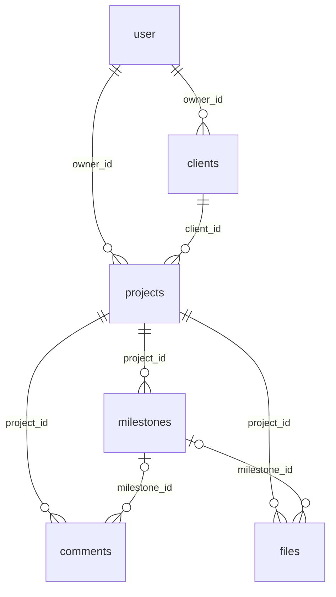

# StatusDEV

Портал клієнта для фрілансерів: власник веде клієнтів, проєкти й етапи, а клієнт за секретним посиланням (без акаунта) бачить прогрес, що потрібно від нього, і може написати коментар.

## Як це працює

Проєкт побудований як монорепозиторій (npm workspaces) із трьох частин:

- **`web/`** — інтерфейс (React + Vite): кабінет власника і публічний портал клієнта.
- **`api/`** — бекенд (Fastify + Drizzle + Better Auth): зберігає дані в PostgreSQL, файли в Cloudflare R2, віддає їх `web`.
- **`shared/`** — спільні TypeScript-типи і Zod-схеми, якими користуються і `api`, і `web`.

Загальний потік: власник створює проєкт з етапами у `web` → `api` зберігає їх у базі → власник ділиться посиланням на портал → клієнт бачить актуальний прогрес і коментує.

## Запуск локально

1. Встанови залежності (з кореня репо, ставить одразу для всіх трьох частин):
   ```bash
   npm install
   ```
2. Підніми Postgres (`docker compose up -d` або свій локальний) і створи `api/.env` з прикладу: `cp api/.env.example api/.env`. Заповни змінні; якщо чогось бракує, API при старті покаже, що саме і де це взяти.
3. Запусти все одним командою:
   ```bash
   npm run dev
   ```
   Скрипт перевіряє `api/.env` і підключення до бази, накочує нові міграції (`--no-migrate`, щоб пропустити), збирає `shared`, а потім піднімає `api` (http://localhost:3001, документація на `/docs`) і `web` (http://localhost:5173). Логи йдуть у консоль з префіксами і ще в `logs/api.log` та `logs/web.log`. Ctrl+C зупиняє обидва.
4. Демо-дані (необов'язково):
   ```bash
   npm run db:seed
   ```
   Створює користувача `t1@example.com` / `12345678` з клієнтами та проєктами в різних станах (прострочений етап, портал із паролем `demo1234`, завершений проєкт) і друкує посилання на портали. Скрипт можна запускати повторно: дані цього користувача створюються заново. З `NODE_ENV=production` він не працює.

Окремо, якщо потрібно: `npm run dev:api`, `npm run dev:web`, `npm run db:migrate`, `npm run build:shared`.

## Режими: NODE_ENV і проксі

- `NODE_ENV=development` задайте в `api/.env` для локальної розробки (є в `.env.example`; `npm run dev` ставить його сам). **Без значення сервер працює як production**: вебхуки лише https і лише на публічні адреси, Swagger вимкнений, `db:seed` відмовляється запускатись.
- Якщо API стоїть за reverse proxy або балансувальником, задайте `TRUST_PROXY=true`, інакше `req.ip` буде адресою проксі: ліміти запитів спільні для всіх клієнтів, а в підписі документа збережеться чужа IP.

## Документація API

Swagger UI: http://localhost:3001/docs, специфікація OpenAPI: `/openapi.json`. Вона збирається з тих самих Zod-схем `shared/`, якими маршрути перевіряють запити (`api/src/openapi.ts`), тому тіла запитів не розходяться з кодом. Тест `api/test/openapi.test.ts` падає, якщо додати маршрут і не описати його. У `production` документація вимкнена, увімкнути можна через `DOCS_ENABLED=true`.

## Логи і помилки

- **Логи.** Pino пише JSON у stdout. Змінна `LOG_FILE` (напр. `logs/api.log`) дублює їх у файл; `npm run dev` задає її сам. Cookie і заголовки в лог не потрапляють, токен порталу в адресах замінено на `[token]`. Папка `logs/` у `.gitignore`.
- **Sentry.** Задай `SENTRY_DSN` в `api/.env`, і помилки 5xx та необроблені винятки підуть у Sentry. Для фронтенду `VITE_SENTRY_DSN` (SDK підвантажується окремим чанком лише з ним). Cookie, заголовки, тіла запитів та токени порталу з подій прибираються.

## Схема БД

Джерело правди — `api/src/db/schema.ts` (Drizzle), міграції в `api/drizzle/`. Облікові записи власників (`user`, `session`, `account`, `verification`) веде Better Auth, див. `api/src/db/auth-schema.ts`.



| Таблиця | Призначення | Ключові поля |
|---|---|---|
| `user` | Власник (фрілансер), керує Better Auth | `plan` (`free` за замовчуванням, інше = без ліміту), `brand_name`, `brand_color` для порталу |
| `clients` | Клієнти власника | `owner_id`, `name`, `email`, `phone`, `notes` |
| `projects` | Проєкти клієнта | `owner_id`, `client_id`, `title`, `status` (`active` / `paused` / `done` / `archived`), `deadline`, `share_token` (секретне посилання для клієнта, `null` = вимкнено); `updated_at` оновлюється при будь-якій зміні етапів і коментарів |
| `milestones` | Етапи проєкту | `project_id`, `position` (1..N без дірок), `status` (`todo` / `in_progress` / `done`), `due_date`, `client_action` (що має зробити клієнт), `completed_at` (ставиться при переході в `done`, чиститься при виході), `client_response` / `client_response_note` / `client_responded_at` (відповідь клієнта з порталу), `soon_reminded_at` / `overdue_reminded_at` (коли надіслано нагадування про дедлайн) |
| `comments` | Коментарі до проєкту або етапу | `author_type` (`owner` / `client`), `author_id` (`null` для клієнта: у нього немає акаунта), `milestone_id` необов'язковий |
| `files` | Файли проєкту (метадані) | `storage_key`, `mime_type`, `size_bytes`, `uploaded_by`, `milestone_id` необов'язковий |
| `documents` | Запити на погодження файлу | `project_id`, `file_id` (каскадно), `title`, `status` (`pending` / `approved` / `changes_requested`), `signer_name`, `signer_ip`, `note`, `responded_at` |
| `activity_events` | Історія подій проєкту | `project_id`, `type`, `actor_type` (`owner` / `client` / `system`), `actor_id`, `milestone_id` (`SET NULL`), `data` (jsonb: назви етапів і файлів, щоб історія пережила видалення) |

Правила, на які спирається код:

- **Власник у кожній вибірці.** `clients` і `projects` мають `owner_id`; етапи, коментарі й файли належать власнику через проєкт. Чужі дані дають 404, не 403.
- **Видалення.** Усі зв'язки `ON DELETE CASCADE`, крім `files.milestone_id` (`SET NULL`). `DELETE /projects/:id` не видаляє, а ставить `archived`; клієнта з проєктами видалити не можна (409, перевіряється в коді).
- **Ліміт Free:** до 2 проєктів зі статусом `active`; `paused`, `done` і `archived` не рахуються.
- **Порядок етапів** задається `position`; змінюється лише через API (додавання в кінець, `PUT .../milestones/order`, перенумерація після видалення).

## Портал клієнта

Клієнт без акаунта відкриває `http://localhost:5173/p/<токен>`: бачить етапи, прогрес, що потрібно від нього, і може написати коментар. Доступ дає лише токен у посиланні (24 випадкові байти, неможливо вгадати).

- Власник керує посиланням на сторінці проєкту: створити, скопіювати, оновити (старе одразу перестає працювати), вимкнути. API: `POST` і `DELETE /projects/:id/share`.
- Публічно (без сесії): `GET /portal/:token` і `POST /portal/:token/comments` (лише текст до 2000 символів, зберігається з `author_type = client`).
- Недійсний, вимкнений і архівний проєкт дають однакову відповідь 404 «Посилання недійсне».
- Портал віддає тільки потрібне клієнтові: без email і id власника. Назва в шапці береться з `brand_name` (або імені власника), колір з `brand_color`; колір тексту на ньому рахується за контрастом WCAG.
- Сторінка порталу має `noindex`, відповідь API `Cache-Control: no-store`.

Що ще не вирішено (для обговорення з напарником): обмеження частоти коментарів із порталу (публічний запис без захисту від спаму); де власник задає `brand_name` і `brand_color` (поля є, інтерфейсу немає).

### Захист посилання: термін дії і пароль

- `POST /projects/:id/share` приймає необов'язкове тіло `{ "expiresAt": "...", "password": "..." }`; `PATCH /projects/:id/share` змінює їх, не міняючи сам токен (`null` знімає). Пароль від 6 символів, зберігається як scrypt-хеш і назовні не віддається (власник бачить лише `sharePasswordSet`).
- Після `expiresAt` портал відповідає **410** `LINK_EXPIRED` (клієнт бачить «Термін дії посилання минув»). Вимкнення посилання скидає і термін, і пароль.
- Портал із паролем відповідає **401** `PORTAL_PASSWORD_REQUIRED`. Клієнт вводить пароль у `POST /portal/:token/unlock` і отримує `accessToken` (діє 12 годин), який далі надсилає в заголовку `X-Portal-Access`. Токен прив'язаний до проєкту і хеша пароля: зміна пароля анулює всі видані. Спроби підбору обмежено: 10 за 10 хвилин на пару адреса + токен.

### Бренд і логотип

Власник задає назву, колір і логотип на сторінці **Налаштування**; клієнт бачить їх у шапці порталу. Логотип (PNG, JPEG або WebP до 1 МБ; SVG заборонено, бо може нести скрипти) іде в R2 тим самим шляхом, що й файли: `POST /me/logo/presign` → PUT на повернену адресу → `PUT /me/logo`. Старий логотип з R2 видаляється. Для показу API віддає тимчасове підписане посилання (`brandLogoUrl` у `/me`, `owner.logoUrl` у порталі), а не ключ об'єкта.

### Документи на погодження (договір, ТЗ)

Власник завантажує файл у проєкт і надсилає його на погодження (`POST /projects/:id/documents`), клієнт отримує лист. У порталі клієнт відкриває документ (тимчасове посилання) і або **підписує його іменем**, або просить правки з описом. При підписі зберігаються ім'я, час і IP (власник бачить їх у проєкті). Погоджений документ остаточний: щоб змінити, власник скасовує запит і створює новий. Це простий підпис за іменем, а не кваліфікований електронний підпис.

### Відповідь клієнта на етап

`POST /portal/:token/milestones/:id/response` з `{ "response": "approved" }` або `{ "response": "changes_requested", "note": "..." }` (для правок опис обов'язковий). Відповісти можна на завершений етап або етап із «що потрібно від клієнта» (`canRespond` у відповіді порталу). Правки до завершеного етапу повертають його в `in_progress`, а текст правок потрапляє і в коментарі. Коли власник змінює статус етапу чи «що потрібно від клієнта», стара відповідь скидається.

## Сповіщення, нагадування, історія

- **Листи (Resend).** Клієнту: етап став «в роботі» або «готово» (лише коли є email клієнта й активне посилання; повернення в «очікує» листа не шле). Власнику: клієнт залишив коментар, прийняв етап або попросив правки. Помилка Resend лише логується, запит це не ламає. У тестах листи не надсилаються.
- **Нагадування про дедлайни.** Процес API раз на `REMINDERS_INTERVAL_MINUTES` хвилин (за замовчуванням 60, `0` вимикає) шукає незавершені етапи активних проєктів: «скоро» (до дедлайну менше 48 годин) і «прострочено» (минув весь день дедлайну). Кожне нагадування йде один раз; зміна `due_date` дає нове. Власник отримує завжди, клієнт лише про етапи з «що потрібно від клієнта». При кількох інстансах API дублів не буде: нагадування «займається» в базі перед відправкою.
- **Telegram.** Задай `TELEGRAM_BOT_TOKEN` (бот від @BotFather). На сторінці **Налаштування** власник натискає «Підключити Telegram», відкриває бота і тисне Start; одноразовий код (15 хвилин) прив'язує чат. Бот працює через long polling, публічна адреса не потрібна, але запускати його слід лише в одному інстансі API. `/stop` відключає. Сюди приходять ті самі події, що й листи власнику: коментарі, відповіді на етапи й документи, дедлайни.
- **Вебхук.** Власник вказує адресу, і StatusDEV шле на неї `POST` із JSON `{ event, occurredAt, project, data }` (події `client.comment`, `client.milestone_response`, `client.document_response`, `deadline.soon`, `deadline.overdue`, `test`). Підпис: заголовок `X-StatusDEV-Signature: sha256=<HMAC-SHA256 тіла секретом з налаштувань>`. Захист від SSRF: у проді лише https; адреси з приватних мереж і метаданих хмари (включно з IPv4, вбудованим в IPv6) відхиляються і при збереженні, і в момент з'єднання (захист від DNS-rebinding); редіректи не виконуються; таймаут 5 с. Автоповторів немає: збій лише логується. Кнопка «Надіслати тестове сповіщення» показує стан кожного каналу.
- **Шаблони проєктів.** `GET /project-templates` повертає набори етапів (сайт, лендинг, мобільний застосунок, брендинг, SMM); `POST /projects` приймає `template`. Набори живуть у `api/src/services/milestone-templates.ts`.
- **Історія.** `GET /projects/:id/activity?limit=50&before=<дата>` (новіші зверху) пише зміни статусів, етапи, коментарі, файли, посилання й відповіді клієнта.

## Чат команди (owner / PM / junior)

Власник проєкту додає зареєстрованих користувачів як `pm` або `junior` (`POST /projects/:id/members`). Листуватись можуть лише пари **owner↔pm** і **pm↔junior**; owner і junior напряму не спілкуються. Правило одне на весь код: `canChat()` у `api/src/services/chat.ts`.

- Чужий проєкт і не-учасник дають 404, заборонена пара дає 403.
- Переписку бачать тільки двоє її учасників: owner не бачить розмову PM із джуном.
- Відправник береться з сесії, не з тіла запиту. Ліміт: 30 повідомлень за хвилину.
- API: `GET/POST/DELETE /projects/:id/members`, `GET /projects/:id/chat/contacts`, `GET/POST /projects/:id/chat/:userId/messages` (`?after=<id>&limit=` для опитування).

## Bruno-колекція запитів

У `bruno/StatusDEV/` лежить колекція для [Bruno](https://www.usebruno.com/): відкрий її (Open Collection), вибери оточення `local` і запускай запити. Спершу `auth/Sign up` (або `Sign in`), далі решта — Bruno зберігає cookie сесії сам. `Create client` і `Create project` записують `clientId` та `projectId` у змінні, тож наступні запити працюють одним кліком.

## Тести

Бекенд тестується через Vitest і `app.inject()` (без піднятого сервера). Потрібен лише запущений Postgres (`docker compose up -d`):

```bash
npm test            # з кореня; або `npm test` в api/
```

### E2E (Playwright)

Сценарії в `e2e/tests/`: реєстрація і вхід, проєкт із шаблону, портал клієнта з паролем (прийняти етап, коментар), вимкнене посилання, налаштування бренду. Playwright сам піднімає окремі `api` (порт 3101) і `web` (5174) та свіжу базу `statusdev_e2e` (потрібен лише Postgres), тож dev-сервери й dev-база не заважають. `NODE_ENV=test` вимикає реальні листи Resend; R2 у сценаріях не використовується.

```bash
npx playwright install chromium   # один раз
npm run e2e
```

CI (`.github/workflows/ci.yml`) запускає на кожен PR: typecheck, lint і тести `api`, lint і збірку `web`, а також E2E.

Перед запуском тести самі створюють окрему базу `statusdev_test` (стару видаляють) і накочують міграції, тож dev-база не чіпається. Інший сервер: змінна `TEST_DATABASE_URL` (назва бази має закінчуватись на `_test`). Хелпери в `api/test/helpers.ts`: `createTestApp()`, `resetDb()`, `createUser(app)` (повертає cookie сесії) і `as(user)` для заголовків.
