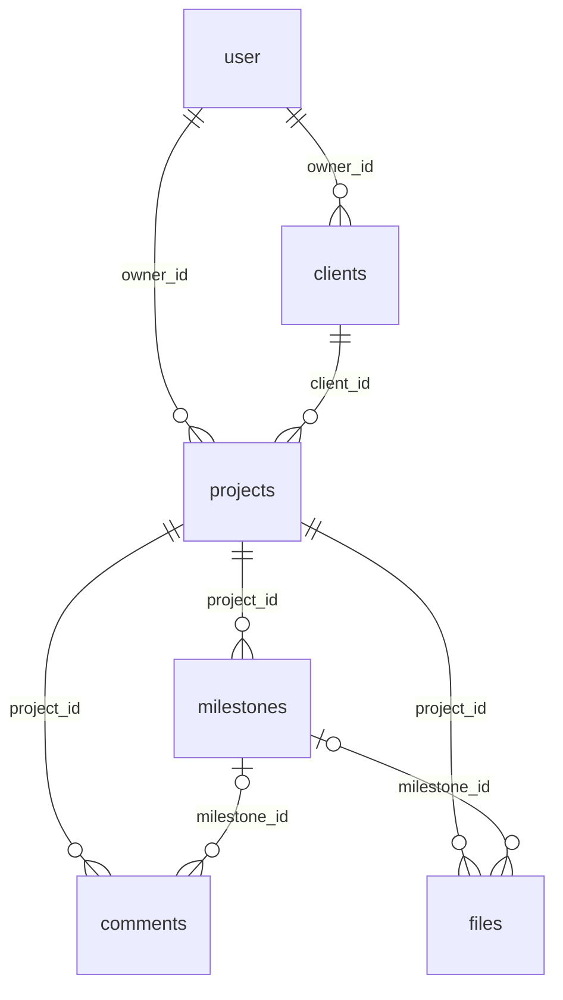

# StatusDEV

Трекер статусу розробника/команди — показує, над чим зараз хтось працює і наскільки він активний.

## Як це працює

Проєкт побудований як монорепозиторій (npm workspaces) із трьох частин:

- **`web/`** — інтерфейс (React + Vite), де користувач бачить і оновлює свій статус (наприклад, "працюю над задачею X", "на зустрічі", "офлайн").
- **`api/`** — бекенд (Fastify + Drizzle), який приймає оновлення статусу від `web`, зберігає їх у PostgreSQL і віддає поточні статуси всіх користувачів/команди.
- **`shared/`** — спільні TypeScript-типи (наприклад, структура статусу), якими користуються і `api`, і `web`, щоб не дублювати код.

Загальний потік: користувач змінює статус у `web` → запит іде в `api` → `api` зберігає зміну в базі → всі, хто дивиться дашборд, бачать оновлений статус.

## Запуск локально

1. Встанови залежності (з кореня репо, ставить одразу для всіх трьох частин):
   ```bash
   npm install
   ```
2. Збери `shared`:
   ```bash
   npm run build:shared
   ```
3. Підніми Postgres і налаштуй `api`: `docker compose up -d` (або свій локальний Postgres), скопіюй `api/.env.example` в `api/.env` і застосуй міграції:
   ```bash
   cd api
   npm run db:migrate
   ```
4. Запусти бекенд і фронтенд (кожен в окремому терміналі):
   ```bash
   npm run dev:api   # http://localhost:3001
   npm run dev:web   # http://localhost:5173
   ```

## Схема БД

Джерело правди — `api/src/db/schema.ts` (Drizzle), міграції в `api/drizzle/`. Облікові записи власників (`user`, `session`, `account`, `verification`) веде Better Auth, див. `api/src/db/auth-schema.ts`.



| Таблиця | Призначення | Ключові поля |
|---|---|---|
| `user` | Власник (фрілансер), керує Better Auth | `plan` (`free` за замовчуванням, інше = без ліміту), `brand_name`, `brand_color` для порталу |
| `clients` | Клієнти власника | `owner_id`, `name`, `email`, `phone`, `notes` |
| `projects` | Проєкти клієнта | `owner_id`, `client_id`, `title`, `status` (`active` / `paused` / `done` / `archived`), `deadline`; `updated_at` оновлюється при будь-якій зміні етапів і коментарів |
| `milestones` | Етапи проєкту | `project_id`, `position` (1..N без дірок), `status` (`todo` / `in_progress` / `done`), `due_date`, `client_action` (що має зробити клієнт), `completed_at` (ставиться при переході в `done`, чиститься при виході) |
| `comments` | Коментарі до проєкту або етапу | `author_type` (`owner` / `client`), `author_id` (`null` для клієнта: у нього немає акаунта), `milestone_id` необов'язковий |
| `files` | Файли проєкту (метадані) | `storage_key`, `mime_type`, `size_bytes`, `uploaded_by`, `milestone_id` необов'язковий |

Правила, на які спирається код:

- **Власник у кожній вибірці.** `clients` і `projects` мають `owner_id`; етапи, коментарі й файли належать власнику через проєкт. Чужі дані дають 404, не 403.
- **Видалення.** Усі зв'язки `ON DELETE CASCADE`, крім `files.milestone_id` (`SET NULL`). `DELETE /projects/:id` не видаляє, а ставить `archived`; клієнта з проєктами видалити не можна (409, перевіряється в коді).
- **Ліміт Free:** до 2 проєктів зі статусом `active`; `paused`, `done` і `archived` не рахуються.
- **Порядок етапів** задається `position`; змінюється лише через API (додавання в кінець, `PUT .../milestones/order`, перенумерація після видалення).

Що ще не вирішено (для обговорення з напарником): як клієнт потрапляє на портал (у схемі немає токена чи посилання доступу), та як зберігаються файли (є тільки метадані, ендпоінтів завантаження ще немає).

## Bruno-колекція запитів

У `bruno/StatusDEV/` лежить колекція для [Bruno](https://www.usebruno.com/): відкрий її (Open Collection), вибери оточення `local` і запускай запити. Спершу `auth/Sign up` (або `Sign in`), далі решта — Bruno зберігає cookie сесії сам. `Create client` і `Create project` записують `clientId` та `projectId` у змінні, тож наступні запити працюють одним кліком.

## Тести

Бекенд тестується через Vitest і `app.inject()` (без піднятого сервера). Потрібен лише запущений Postgres (`docker compose up -d`):

```bash
npm test            # з кореня; або `npm test` в api/
```

Перед запуском тести самі створюють окрему базу `statusdev_test` (стару видаляють) і накочують міграції, тож dev-база не чіпається. Інший сервер: змінна `TEST_DATABASE_URL` (назва бази має закінчуватись на `_test`). Хелпери в `api/test/helpers.ts`: `createTestApp()`, `resetDb()`, `createUser(app)` (повертає cookie сесії) і `as(user)` для заголовків.
